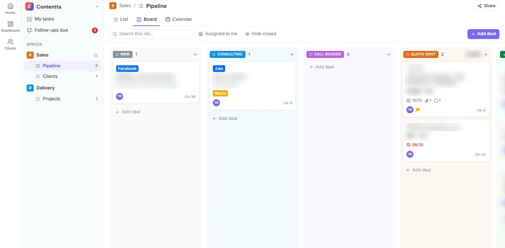
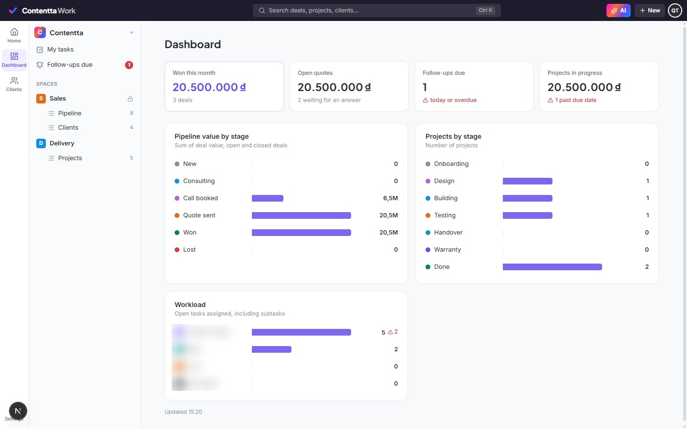

# clone-saas-app

Skill cho Claude Code: làm bản thu nhỏ của một phần mềm SaaS (ClickUp, Notion, HubSpot...) cho riêng công ty bạn, có dữ liệu thật và API cho AI agent đọc/ghi. Claude nghiên cứu app gốc để hiểu vì sao có từng tính năng, đề xuất scope + mockup cho bạn duyệt, rồi mới build, import dữ liệu và deploy.



**Không có demo public.** Ví dụ gốc là Contentta Work, bản ClickUp thu nhỏ (CRM + quản lý dự án) cho agency Contentta. App chạy nội bộ sau 2 lớp mật khẩu, nên repo chỉ có ảnh chụp đã làm mờ tên khách.



## Ví dụ gốc làm trong 1 ngày

Prompt gửi lúc 9:28. 10:43 có mockup, 15:21 xong UI thật, 15:31 import xong dữ liệu thật từ sheet và file báo giá, 16:35 chạy trên VPS.

Đã chạy thật: board kéo thả, list sửa inline, panel task, trang khách hàng gom mọi deal và dự án, tìm không dấu bằng Ctrl+K, dashboard, phân quyền theo space, REST API có token, import có bước dry-run, deploy Docker + nginx + backup.

Mới ở mức thiết kế (có trong plan và bảng DB, chưa có code): automation engine, webhook ra, inbound từ form và chatbot, MCP server. Skill ghi rõ phần nào đã chạy, phần nào là thiết kế.

## Quy trình

| Phase | Việc | Ai quyết |
|---|---|---|
| 1. Nghiên cứu | 3 hướng song song: help docs + API docs + brand page của app gốc, dữ liệu thật của bạn, code và hạ tầng sẵn có. Ra bảng "tính năng / vì sao app gốc có / mình có cần không" | Claude hỏi bạn các câu chốt |
| 2. Đề xuất | Plan: scope, data model, views, automation, API + MCP, stack, milestones có verify | **Bạn duyệt plan** |
| | Mockup `/mockup` dùng dữ liệu thật, 2-3 phương án logo | **Bạn duyệt mockup** |
| 3. Build + verify | Schema, đăng nhập, lớp domain ghi bảng events, REST API, UI thật, smoke test, Playwright | Claude |
| | Import `--dry` ra bảng: dòng nào nhập, gộp, bỏ, kèm lý do | **Bạn duyệt bản import** |
| | Import thật, deploy VPS, backup | Claude, hỏi trước thao tác xoá |

Bài học chính về data model: **Khách hàng là bản ghi trung tâm.** Deal và Dự án là bản ghi riêng nối về Khách, giống Relationship + Rollup của ClickUp. 1 khách nhiều dự án vẫn gom được trên 1 trang.

Mọi thay đổi dữ liệu đi qua lớp domain và ghi 1 dòng `events` trong cùng transaction. Dòng đó là activity log trên giao diện, đồng thời là hàng đợi cho automation và webhook.

## Cài đặt

Cần [Claude Code](https://claude.com/claude-code). App sinh ra dùng Node 20+, pnpm, Docker (Postgres), Playwright để verify.

Clone repo vào thư mục skill của Claude Code:

```bash
# macOS / Linux
git clone https://github.com/thanhthuduc99/clone-saas-app ~/.claude/skills/clone-saas-app

# Windows (PowerShell)
git clone https://github.com/thanhthuduc99/clone-saas-app "$env:USERPROFILE\.claude\skills\clone-saas-app"
```

Mở Claude Code, gõ `/clone-saas-app` hoặc nói thẳng yêu cầu.

## Prompt mẫu

```
Mình muốn bạn reverse engineer ClickUp để làm 1 bản nhỏ cho công ty mình,
gồm CRM (Sales) và Project Management. Giao diện tương tự ClickUp, logo riêng.
Dữ liệu khách hàng, lead, dự án đã chốt nằm trong sheet <link> và thư mục báo giá <đường dẫn>.
Tìm hiểu kỹ vì sao ClickUp có các tính năng như Automation, kết nối AI, rồi làm cho mình phần tương tự.
App cần đủ API để AI agent kết nối và chạy khi có lead mới hay báo giá mới.
Phase 1 nghiên cứu. Phase 2 đề xuất tính năng. Phase 3 verify và chỉnh sửa. Cần gì thì hỏi lại.
```

Đổi ClickUp thành Notion, HubSpot, Trello... tuỳ app bạn muốn làm bản nhỏ.

## Cấu trúc

```
SKILL.md                     quy trình 3 phase, 2 điểm dừng chờ duyệt
references/
  clickup-example.md         bảng tính năng ClickUp đã làm, cấu trúc workspace, automation, user sửa gì sau mockup
  data-model.md              schema tổng quát (20 bảng), relationship + rollup, quyền, tìm không dấu
  api-mcp.md                 REST route, quy ước lỗi, webhook, inbound, MCP tools, 30 smoke check
  pitfalls.md                checklist bẫy: Next 16, dnd-kit, Playwright, import, Docker, nginx
templates/
  plan.md                    khung plan để điền
  smoke-api.mjs              khung smoke test API, chỉ in PASS/FAIL
```

## Ghi chú

- ClickUp chỉ là app tham khảo để học cách tổ chức tính năng. Skill không chứa code, logo hay tài sản nào của ClickUp. Khi làm bản riêng, dùng tên và logo của bạn.
- Dữ liệu khách thật chỉ nằm trong project của bạn (thư mục `data/` để trong `.gitignore`). Push code lên repo public thì kiểm lại file seed.

Tác giả: Thành Vũ Đức (Contentta). License MIT.
